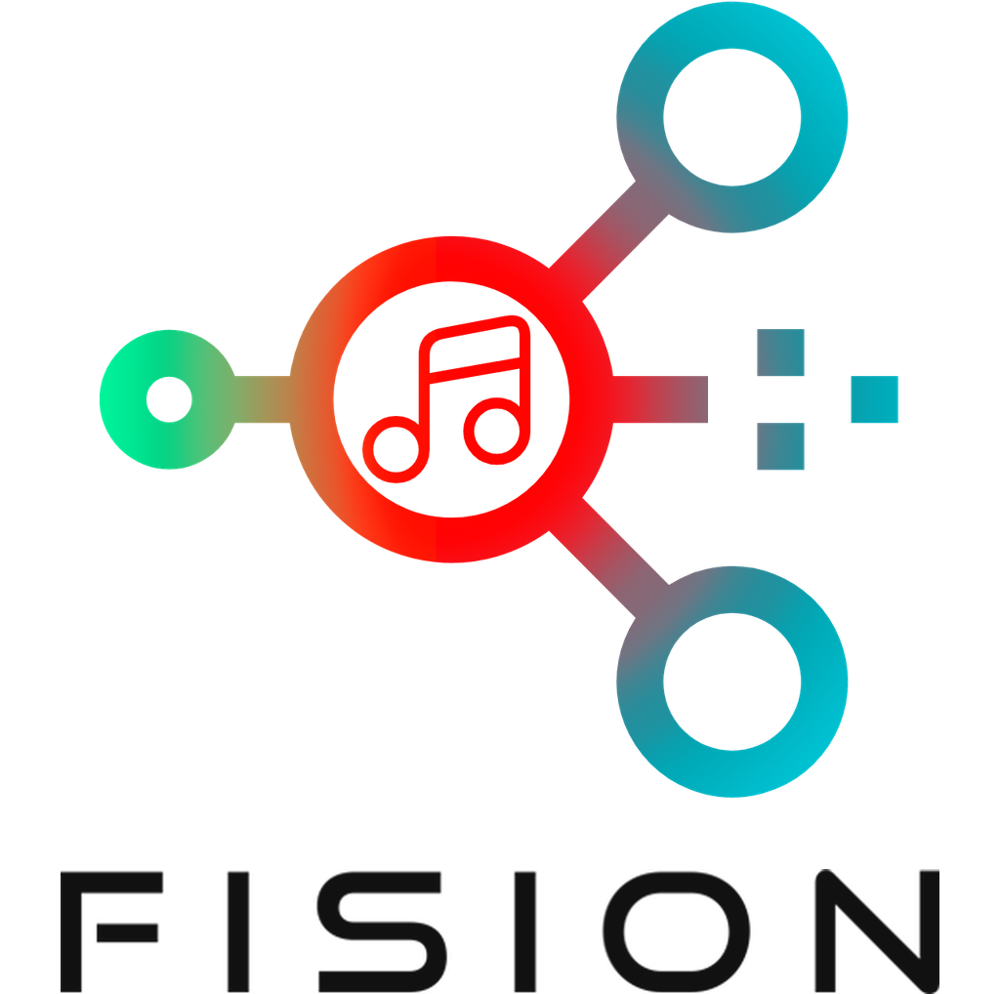
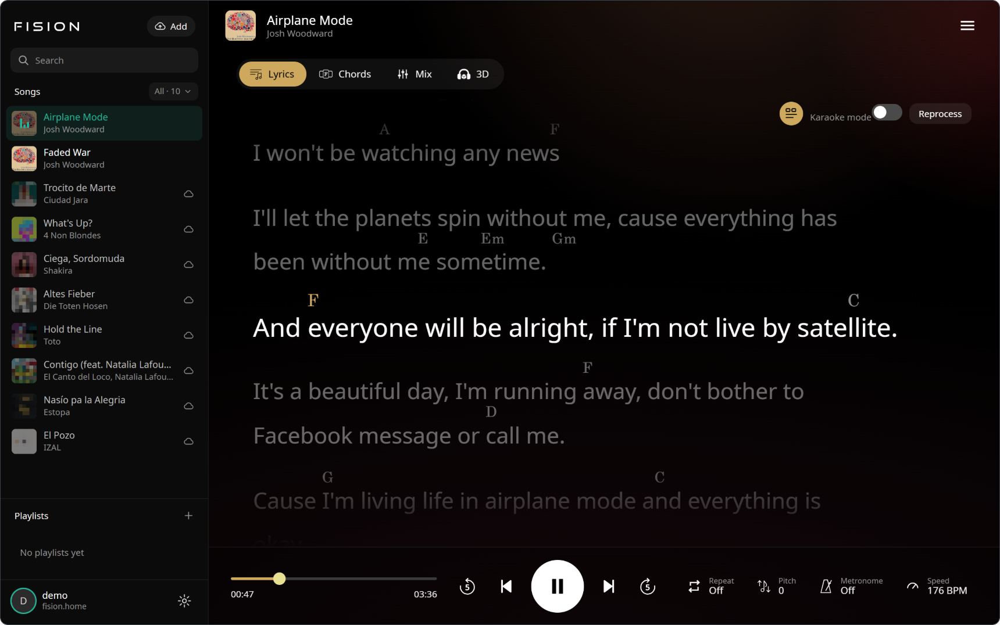
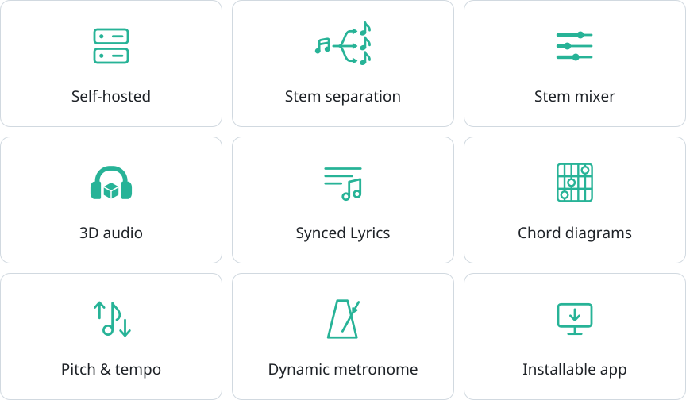
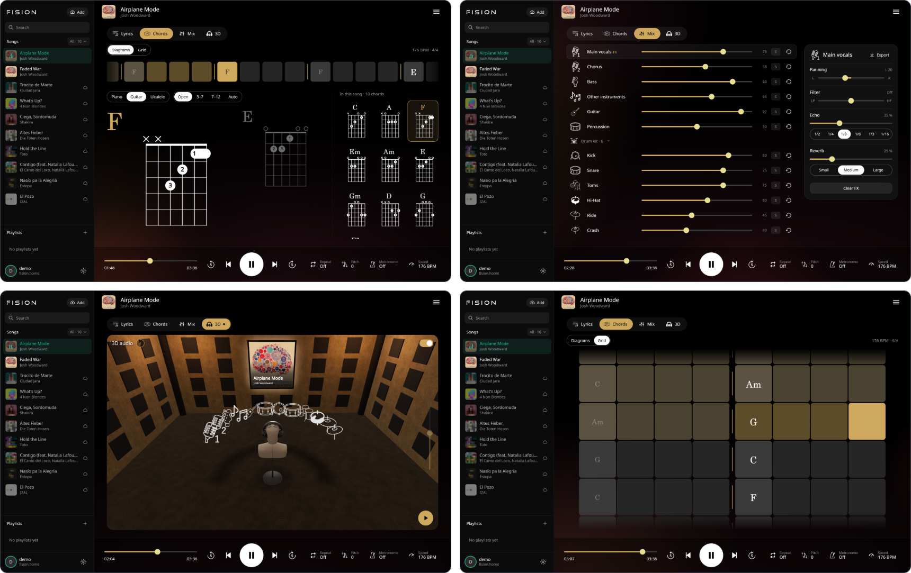
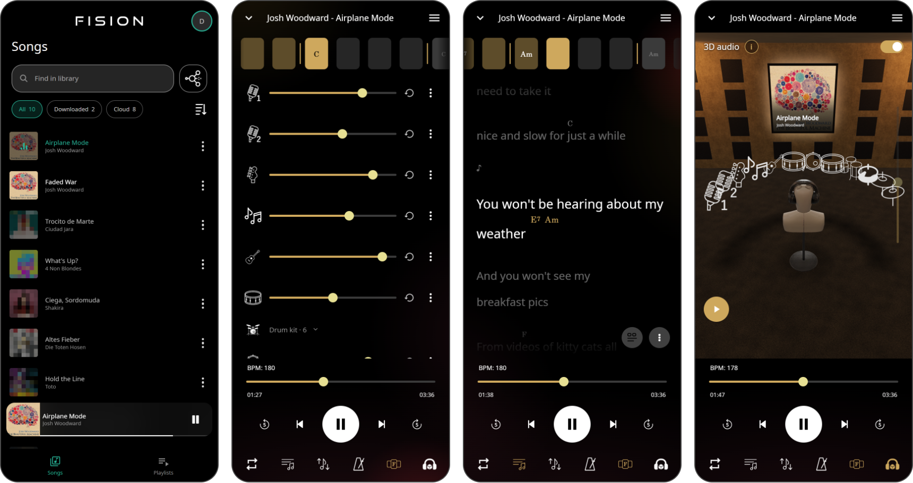
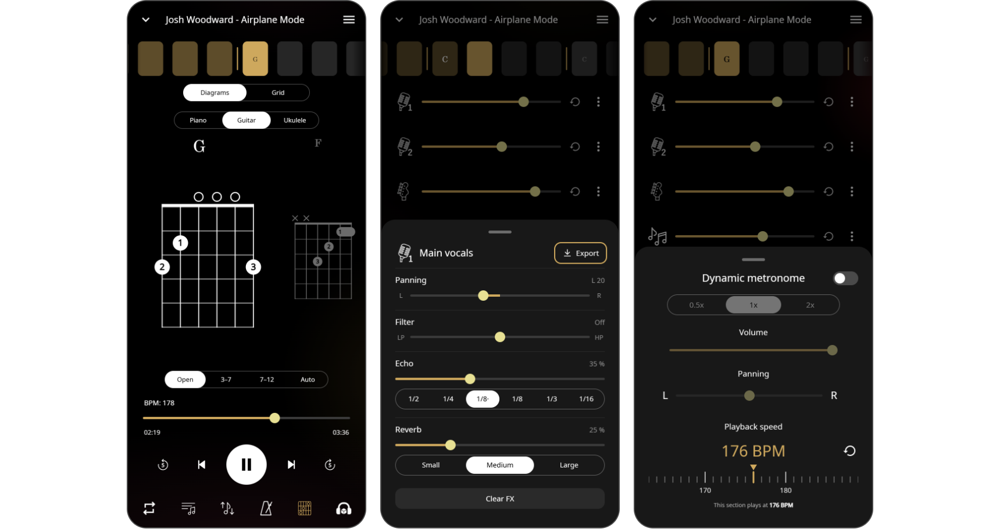
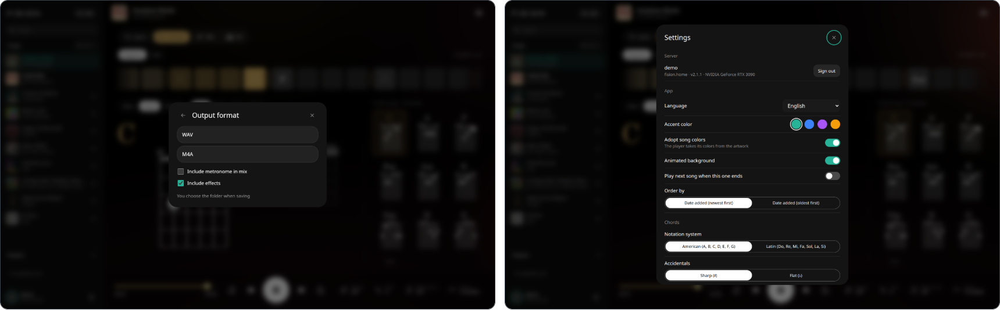

<div align="center">
  <picture>
    <source media="(prefers-color-scheme: dark)" srcset="./docs/readme/title_dark.png">
    
  </picture>
  <p><b>The magic starts with the fision of your music.</b></p>
  <p>
    
    
    
    <a href="https://github.com/jotapemj/Fision-Server"></a>
    <a href="https://github.com/jotapemj/Fision-AppAndroid"></a>
    <a href="LICENSE"></a>
  </p>
</div>

Fision Web is the browser version of the
[Fision app](https://github.com/jotapemj/Fision-AppAndroid). It signs in to
your own [FisionServer](https://github.com/jotapemj/Fision-Server), downloads
the separated songs into the browser and plays them through the same native
engine as the app, compiled to WebAssembly. Built for the big screen of a
computer, and laid out like the app on a phone.

<br>

<div align="center">
  
</div>

<br>

## Features

<div align="center">
  <picture>
    <source media="(prefers-color-scheme: dark)" srcset="./docs/readme/features-dark.svg">
    
  </picture>
</div>

* **Stem mixer** with volume, balance, solo and per-stem effects (filter,
  tempo-synced echo and reverb).
* **Pitch and tempo** live, with the metronome at half, normal and double
  speed and an optional sound on the downbeat.
* **Chords** as a beat strip, a grid of the whole song and diagrams for
  guitar, ukulele and piano.
* **Synced lyrics** with karaoke and chords over the words.
* **3D audio** (HRTF) in a room scene or a flat view, with dancing stems.
* **Playlists**, upload and reprocessing, stored on your server.
* **Export** the mix or each stem to WAV or M4A.
* **Works offline** once a song is downloaded, and installs as an app (PWA).
* **10 languages**, the same as the app.

## Screenshots

<div align="center">
  
  <br><br>
  
</div>

<details>
<summary><b>More screenshots</b></summary>
<br>
<div align="center">
  
  <br><br>
  
</div>
</details>

## Getting started

There is nothing to install: the web comes with
[FisionServer](https://github.com/jotapemj/Fision-Server).

1. Run a FisionServer and give it HTTPS (see [HTTPS](#https)).
2. Open `https://<machine>.<tailnet>.ts.net/app/` in a browser and sign in
   with your account.
3. Optionally, install it as an app from the browser menu.

## HTTPS

> [!IMPORTANT]
> The web needs HTTPS. The audio engine runs in an AudioWorklet with shared
> memory, and the downloaded songs live in the browser's private storage.
> Browsers only allow both in a secure context, and shared memory also needs
> the `Cross-Origin-Opener-Policy` and `Cross-Origin-Embedder-Policy`
> headers. Over plain HTTP the player does not start.

FisionServer speaks plain HTTP. The simplest way to give it HTTPS is
[Tailscale Serve](https://tailscale.com/kb/1312/serve), which puts a valid
`*.ts.net` certificate in front of it without opening any port:

1. In the Tailscale admin console, under **DNS**, enable **MagicDNS** and
   **HTTPS Certificates**.
2. On the server, point Serve at the address FisionServer listens on
   (`FISION_BIND`, for example the one from `tailscale ip -4`):

   ```bash
   sudo tailscale serve --bg --https=443 http://<FISION_BIND>:8000
   ```

3. Check it from any device in the tailnet:
   `https://<machine>.<tailnet>.ts.net/health`. The first certificate can
   take a few seconds.

`tailscale serve status` shows the current setup and
`sudo tailscale serve reset` removes it.

Serve only takes over port 443 of that machine. SSH (including Tailscale
SSH), the plain HTTP port and any other service keep working as before, and
the site stays inside the tailnet: Serve never publishes it to the internet
(that would be Tailscale Funnel, which Fision does not need).

## Building from source

Only needed to work on the web itself. Requirements:

* Node.js 24 or newer.
* [Emscripten](https://emscripten.org) to build the audio engine (`emsdk`).
* A FisionServer to sign in to.

```bash
npm install
npm run engine          # builds the WebAssembly engine into public/engine
npm run dev             # http://localhost:5173/app/
```

The dev server forwards the API to `FISION_SERVER`
(default `http://localhost:8000`; set it in the environment or in a git-ignored
`.env.local` as `FISION_SERVER=http://<address>:8000`), so the web and the API
share one origin, as they do when the server hosts the web. `localhost`
already counts as a secure context, so no certificates are needed.

* `npm run build` writes the site to `dist/`, with the service worker.
* `npm run preview` serves that build, also with the API forwarded.
* `npm test` runs the test suite: a fake server, signal checks on the engine
  and headless Chrome for the interface (`CHROME_PATH` if Chrome is not in
  the usual place). `npm test -- <filter>` runs a subset.
* `npm run typecheck` checks the types.

## Credits

Fision Web builds on these projects. Each keeps its own license; the full
list, with texts, is in **Settings → About → Licenses**.

**Audio**

- [SoundTouch](https://www.surina.net/soundtouch/): pitch and tempo. LGPL 2.1.
- [dr_flac](https://github.com/mackron/dr_libs): FLAC decoding. MIT-0 / Public Domain.
- [Emscripten](https://emscripten.org): WebAssembly toolchain and runtime. MIT.
- [KEMAR HRTF measurements](https://sound.media.mit.edu/resources/KEMAR.html),
  MIT Media Lab: free with no restrictions on use, citing the authors.

  > Gardner, W. G., and Martin, K. D. (1995). "HRTF measurements of a KEMAR."
  > Journal of the Acoustical Society of America, 97(6), 3907-3908.

**Web**

- [three.js](https://threejs.org): 3D scene. MIT.
- [mp4-muxer](https://github.com/Vanilagy/mp4-muxer): M4A export. MIT.
- [chords-db](https://github.com/tombatossals/chords-db): guitar and ukulele
  chord shapes. MIT.
- Listener head model of the 3D scene, generated with [Meshy](https://www.meshy.ai).
  [CC BY 4.0](https://creativecommons.org/licenses/by/4.0/).
- [Noto Sans](https://github.com/notofonts/latin-greek-cyrillic) and
  [MusGlyphs](https://www.notationcentral.com/product/musglyphs/): fonts. SIL Open Font License.

**Demo song**

- "Airplane Mode" by [Josh Woodward](https://www.joshwoodward.com/song/AirplaneMode),
  [CC BY 4.0](https://creativecommons.org/licenses/by/4.0/), the song
  FisionServer adds to every new account.

## License

Copyright (C) 2026 Jotapeveloper

Fision Web is free software: you can redistribute it and/or modify it under
the terms of the [GNU General Public License](LICENSE) as published by the Free
Software Foundation, either version 3 of the License, or (at your option) any
later version. Any work based on it must keep this notice and be released
under the same license.

Third-party components keep their own licenses (see [Credits](#credits)).
The KEMAR HRTF data is free to use, including commercially, provided its
authors are cited.
